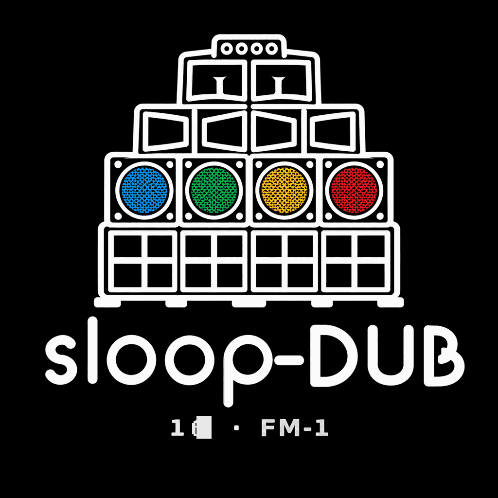
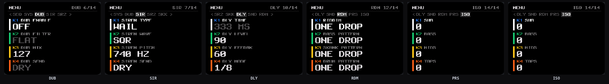
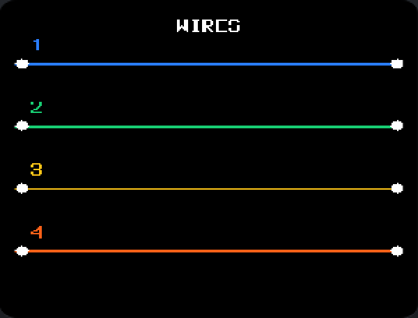
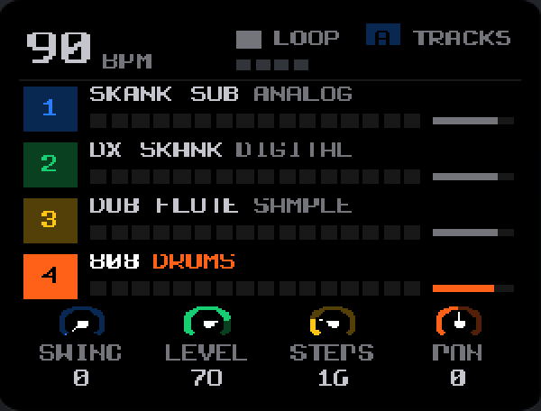
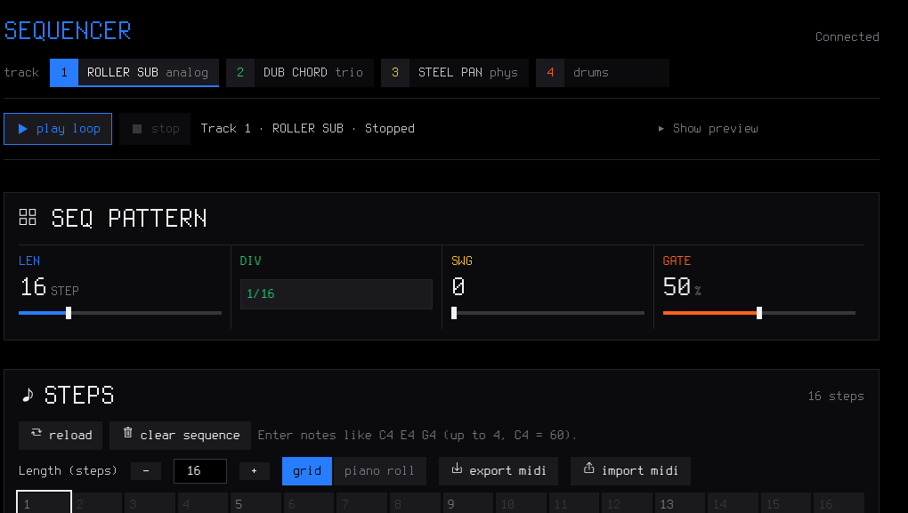
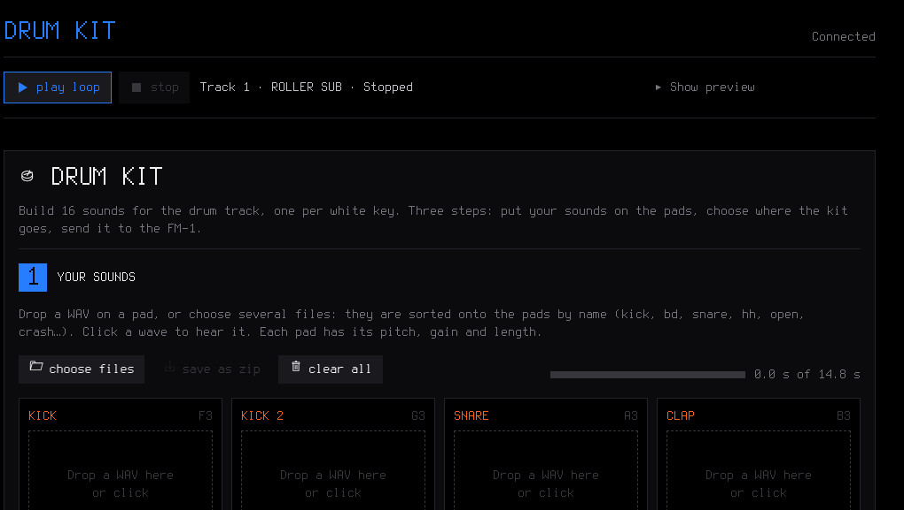

<b>SLOOP DUB — the sound-system firmware for the M-VAVE FM-1.</b> 
A four-track groovebox with a full dub wing and a reggae / dub / ska / jungle / bass-music bank,
free and open source (GPL-3.0), on top of <a href="https://github.com/isod89/sloop-fm1">SLOOP</a>
by isod89, based on <a href="https://github.com/hugelton/Felucca">Felucca</a> by Leo Kuroshita / Hügelton Instruments.

<a href="https://altessproduction.github.io/sloop-dub-fm1/dub/"><b>Play SLOOP Dub in the browser</b></a> ·
<a href="https://altessproduction.github.io/sloop-dub-fm1/webapp/installer/"><b>Install it from the browser</b></a> ·
<a href="docs/firmware/sloop-dub-1.7.fwsc">the 1.7 package (.fwsc)</a> ·
<a href="DUB-FR.md">Le manuel Dub (FR)</a> ·
<a href="GUIDE.md">The complete guide</a> ·
<a href="CHANGELOG.md">Changelog</a> ·
<a href="../../issues">Report a bug</a>

---

**SLOOP Dub** turns the FM-1 into the sound system's machine: **three synths and a drum machine**
you play live, a **DUB module** (bipolar filter, mix, throw), a **dub siren** you hold on OCT+,
**twenty-eight 64-step riddims** that load into the sequencer with their patterns, a four-band
**isolator** whose mutes really cut, a **tape delay** whose TIME knob bends the loop like a real
tape echo, per-track **throws** into the delay, and the **WIRES** visualizer — over the whole
SLOOP base: twelve synthesis engines, **180 sound-system presets** (the genre bank plus the
**Casio MT-40's 22 tones**), **38 drum kits** including the MT-40's rhythm unit, your own samples,
song mode, USB audio, MIDI in on the jack, MIDI clock and MIDI out. Reggae, roots, ska, dub,
dancehall, drum & bass, jungle, ragga jungle, dubstep, UK steppers, bass music — and the MT-40,
the keyboard the Sleng Teng came from: no factory patterns to load, everything you hear, you
play — or you load a riddim and dub over it.

> **Status: SLOOP Dub 1.7 — the classic riddims, transcribed from the records; the Sleng Teng that finally sounds like the Sleng Teng.** The **eleven riddims every sound system
> grew up on** join the bank: **Heavenless, Tonight, Get in the Groove, Hot Milk, Answer,
> Promised Land, Gunman, Here I Come, Sleng Teng, Tempo, Peany Peany** — from the Studio One
> rocksteady of 1967–68 to the first digital dancehall of 1985–87, each one a full 64-step
> riddim with its four patterns, the bass **transcribed from the records themselves** (the
> uploads pitch-tracked note by note on the records' own grid — no factory ROM data, no
> sample copied; the groove is recognisable from the first bar; their origins are in
> [The classic riddims](#the-classic-riddims)). Ten generic riddims step aside so the bank
> stays at **twenty-eight** and the build fits its slot (524 bytes to spare); the MT-40's six
> rhythms, its 22 tones and its kit stay (see [The Casio MT-40](#the-casio-mt-40-the-functions-the-rhythms-the-sounds)).
> The bank counts **180 presets** and **38 kits**, all level-matched. Still custom firmware:
> install at your own risk, and please [report](../../issues) what you find. Your projects,
> presets, samples and settings are kept when you update, and you can go back at any time
> (see [Going back](#going-back)).

## Contents

1. [The Dub wing](#the-dub-wing)
2. [The sound-system bank: 180 presets](#the-sound-system-bank-180-presets)
3. [The drum kits: 38](#the-drum-kits-38)
4. [The riddims: 28](#the-riddims-28)
5. [The classic riddims](#the-classic-riddims)
6. [The Casio MT-40: the functions, the rhythms, the sounds](#the-casio-mt-40-the-functions-the-rhythms-the-sounds)
7. [Your first dub in 60 seconds](#your-first-dub-in-60-seconds)
8. [Screenshots](#screenshots)
9. [The base SLOOP](#the-base-sloop)
10. [Install](#install)
11. [The controls](#the-controls)
12. [The menu: settings of the FM-1](#the-menu-settings-of-the-fm-1)
13. [MIDI and USB audio](#midi-and-usb-audio)
14. [The web editor](#the-web-editor)
15. [Compatibility](#compatibility)
16. [Troubleshooting](#troubleshooting)
17. [Specifications](#specifications)
17. [Documentation](#documentation)
18. [Building](#building)
19. [Contributing](#contributing)
20. [Credits and thanks](#credits-and-thanks)
21. [Licence](#licence)

## The Dub wing

Hold **HOME** to open the menu: SELECT walks the fourteen pages — `SCR · LGT · AUD · SEQ · SYS`
(SLOOP's), then the Dub's **DUB · SIR · SR2 · SKK · DLY · SND · RDM · PRS · ISO**. Each page has
four rows: **KNOB 1–4** set them like potentiometers (a whole course in ~300°), **OCT+** validates
and plays, **OCT−** closes, and **PLAY starts and stops the transport from any page**. (Sur
l'émulateur comme sur la machine, chaque page est expliquée sous le visualiseur ; le manuel
complet du fork est [DUB-FR.md](DUB-FR.md).)

### The DUB module — page DUB

- **DUB ENABLE** (K1) — the module's one switch; nothing else turns Dub on.
- **DUB FILTER** (K2) — a bipolar filter: left is the lowpass (the deeper the lower), right the
  highpass, the centre detent **FLAT** is the untouched signal.
- **DUB MIX** (K3) — dry to wet. **DUB SEND** (K4) — the *throw* into the delay.
- FLAT + the isolator at rest = the sound **bit for bit the original's**, stereo kept.

### The dub siren — pages SIR and SR2

- The sound system's siren: LFO **WAIL · HILO · RAMP · SWEEP · SPACE**, waves
  **SQR · PLS · SAW · TRI · SIN**, pitch 220–1200 Hz, rate 1–16 Hz, depth to two octaves,
  symmetry, **SIREN SEND** into the delay, **SIREN LEVEL**.
- **Hold OCT+** on SIR, SR2 or DLY and the siren sounds at SIREN LEVEL (0 stays silent);
  **release** and it stops; **press again** and it re-arms. Held, it follows SELECT across those
  three pages while the settings scroll.
- The siren is **its own voice**: it sounds with DUB off too, and no isolator band or DUB filter
  ever colours it — it joins the mix after the module, and the master DJ filter still sweeps it.

### The tape delay — page DLY

- **TIME** 40–1400 ms free, **LEVEL** the echo in the mix, **FEEDBK** the repeats, **MODE** FREE
  then the tempo divisions (1/4 … 1/4D) — the knobs cycle it all.
- **Turn TIME while a loop rolls in the delay: the loop speeds up or slows down like a real tape
  echo.** The time glides continuously, the pitch rises as you shorten it and falls as you
  lengthen it, and the bend holds as long as the head moves (a full sweep bends for ~2.7 s).
  While DUB plays, wow and flutter wander and the repeats pass a soft tape saturation.
- DUB off: SLOOP's plain tempo echo, exactly as it always was. OCT+ here is the siren only.

### The per-track throws — page SND

- One potentiometer per sequencer track: **BASS · SKANK · MELODY · DRUM** send into the delay
  (0–100 %, DRY at zero, OCT+ toggles dry ↔ half). Each track doses its own echo; it is saved
  with the project.

### The sequencer, the riddims, the sounds — pages RDM and PRS

- The dub tracks are **SLOOP's own sequencer**: **OCT+ on RDM loads one of the twenty-eight 64-step
  riddims** (the list is [below](#the-riddims-22)) into the four tracks; KN2 / KN3 / KN4 + OCT+
  load one track's pattern alone — the bass, the skanks, the melody or the drums. What loads is
  what plays and what you edit afterwards (PATTERN, NOTES, ACCENTS, SLIDES).
- **ACCENTS and SLIDES** (the SEQ button) add a second sequencer on the flags: a per-step accent
  grid (the step plays at 127) and slides (the note glides into the next instead of re-attacking).
- **PRS** loads real SLOOP presets per track — the bank is [below](#the-sound-system-bank-180-presets)
  — and the drums take the kits: ONE DROP, STEPPERS, JUNGLE, DUBSTEP, RAGGA, DEMBOW…
  **SKK** plays a one-key skank chord (MAJ · MIN · DIM · AUG · 7TH · MIN7 · 9TH · PWR, root,
  octave, velocity).

### The isolator — page ISO

- Four bands **SUB · BASS · MIDS · TOPS** — crossovers at 90 Hz, 420 Hz and 2.6 kHz, stereo — a
  gain knob −24…+12 dB each, and **OCT+ mutes the band**: the mute really cuts that band's
  frequencies.
- A mute or a knob move glides in ~12 ms (no click). Everything at rest, the isolator steps
  aside: the original passes untouched.

### The visualizer

- A short press on HOME: **WIRES**, the four strings that vibrate with the tracks, full screen.
  (The eleven other styles left the firmware for the memory — 7.6 KB of flash and ~7 KB of RAM
  back.)

## The sound-system bank: 180 presets

Every preset of the bank, browsed by kind on the PRESETS knob and the **PRS** page, all
level-matched — 32 more slots hold your own. The engines behind them: ANALOG, 4-op FM (DIGITAL),
FM6 (6-op, DX7), PHASE (CZ), CHIP, SAMPLE, TRIO, VOICE, GRAIN, the physical models (PHYS), NOISE,
and the break **slicer**. A name may appear twice when two engines carry it (FM SUB, DX SKANK,
STEPPA FM, DNB STAB, STEEL PAN, BUBBLE ORG): the device lists both, each sounds its own way.

**Basses** — 28

| | | | |
| --- | --- | --- | --- |
| SKANK SUB | ROOTS 808 | STEPPA SUB | DNB REESE |
| ROLLER SUB | JUNGLE WOB | RAGGA 808 | WOBBLE |
| GROWL | UKG SLIDE | ACID RUB | MELLOW BS |
| FM SUB | DX BASS | STEPPA FM | JUNGLE FM |
| CZ SUB | CHIP BASS | RAGGA BASS | DNB BASS |
| VOX BASS | TRIO BASS | CHORD SUB | FM SUB (FM6) |
| GROWL FM | STEPPA FM (FM6) | PICK BASS | UPRIGHT BS |

**Keys** — 21 (the skank and bubble comping)

| | | | |
| --- | --- | --- | --- |
| DX SKANK | SKA PIANO | DUB TINE | ROOTS CLAV |
| NITE EP | CZ SKANK | CZ ROOTS | CZ BUBBLE |
| CHIP SKANK | CHIP BUBBLE | CHIP LEAD | SKANK PNO |
| DUB PNO | DUB VIBES | DX SKANK (FM6) | DUB KEYS |
| SKANK GTR | UPSTROKE | ROOTS GTR | SKA GTR |
| PICK GTR | | | |

**Organs** — 9

| | | | |
| --- | --- | --- | --- |
| SKANK ORGN | BUBBLE ORG | ROOTS ORG | DUB ORG |
| STEPPA ORG | SKA ORGN | REGGAE ORG | GOSPEL ORG |
| BUBBLE ORG (TRIO) | | | |

**Pads** — 27 (the beds)

| | | | |
| --- | --- | --- | --- |
| SKY PAD | DARK PAD | GONG PAD | VOX FM |
| CZ DUBPAD | BIT PAD | DUB CHANT | RAGGA OOH |
| VOX PAD | STEPPA PAD | WOBBLE PAD | SKY CLOUD |
| HORN HAZE | DUB DUST | STR CLOUD | SHIMMER |
| DUB DRONE | FLUTE SKY | HORN CLOUD | BOW STR |
| TANPURA | WIND | OCEAN | STORM |
| TAPE HISS | VINYL | RISER | |

**Leads** — 18

| | | | |
| --- | --- | --- | --- |
| SIREN | DUB LEAD | MELODICA | SKANK LD |
| FX SLIDE | NITE LEAD | GONG FM | CZ MELO |
| CHIP SIREN | DUB FLUTE | TOAST VOX | DUB VOX |
| SKA VOX | MELODIC FM | DUB SIREN | SIREN 2 |
| AIR HORN | RADIO | | |

**Plucks & bells** — 18

| | | | |
| --- | --- | --- | --- |
| CHIME PLK | AMEN BELL | DUB BELL | RAGGA BELL |
| MARIMBAS | KALIMBAS | FM PLUCK | STEEL PAN |
| CZ RESO | DX BELL | DUB HARP | STEEL PAN |
| KALIMBA | BALAFON | CHIMES | BELL TREE |
| BIG BELL | VIBRA BAR | | |

**Stabs** — 20 (the chords of every genre)

| | | | |
| --- | --- | --- | --- |
| STEPPA STB | ROOTS STB | DUB CHORD | SKA STAB |
| TWO TONE | RAGGA STB | DNB STAB | JUNGLE STB |
| DUBSTEP STB | SKA BRASS | DUB BRASS | RAVE STAB |
| DNB STAB (FM) | CZ BRASS | CHIP STAB | HORN STAB |
| SKA HORNS | DUB HORNS | STRING STB | FM HORNS |

**FX** — 17 (the percussion of the sound system, the slicer)

| | | | |
| --- | --- | --- | --- |
| CHIP NOIS | SCRATCH | GM KIT | CONGAS |
| BONGOS | HAND DRUM | MEMB TOMS | TABLA |
| TIMPANI | BODY KICK | COWBELL | WOOD BLOCK |
| SNARE FX | AMEN CUT | JUNGLE 16 | RAGGA CUT |
| USR SLICE | | | |

**MT40** — 22 (the Casio MT-40's 22 tones, the machine's own numbering 1–22; the story and the
engine behind each is [below](#the-casio-mt-40-the-functions-the-rhythms-the-sounds))

| | | | |
| --- | --- | --- | --- |
| MT E.PIANO | MT BANJO | MT GUITAR | MT HARPSI |
| MT XYLO | MT CELESTA | MT GLOCK | MT ORGAN |
| MT ACCORD | MT PIPE | MT ORIENT | MT BRASS |
| MT CELLO | MT SFUZZ | MT VIOLIN | MT TRUMPET |
| MT FUNNY | MT ENSMBL | MT CLARIN | MT FLUTE |
| MT RECORD | MT FOLKFLT | | |

## The drum kits: 38

All level-matched. The **five sampled kits** are CC0 studio recordings in five treatments; the
**thirty-three synthesised kits** are built like on the classic machines (softer hits are darker as
well as quieter). Your own kits: **USR1–USR4** (or USR3+4, about 15 s) of sample slots filled in
the editor's Drum kit page, and **SYN1–SYN4**, synthesised kits you make in the editor's Drum
synth page.

| Sampled (5) | | | | |
| --- | --- | --- | --- | --- |
| ONE DROP | STEPPERS | SKA | ROCKERS | DUB |

| Synthesised (32) | | | | |
| --- | --- | --- | --- | --- |
| 808 | 909 | 606 | ONEDROP | VINTAGE |
| TRAP | DRILL | BOOMBAP | LO-FI | ROCKERS |
| HOUSE | ROCKSTDY | TECHNO | MINIMAL | ELECTRO |
| SKA | GARAGE | JUNGLE | DUBSTEP | DEMBOW |
| AMAPIANO | AFRO | LATIN | TRIBAL | DIGITAL |
| RUBADUB | ARCADE | RAGGA | INDUSTR | GQOM |
| STEPPERS | JAZZ | MT40 | | |

## The riddims: 28

Twenty-eight 64-step riddims, four bars each, with their **four patterns** — bass, skanks, melody,
drums. **OCT+ on RDM loads the whole riddim** into the tracks; KN2 / KN3 / KN4 + OCT+ load one
track's pattern alone. The loaded bass and melody **strike every written note again — the
same-pitch repeats too** (the Sleng Teng's bounce, the MT-40's plucks); the dub glue holds the
note over the rests as TIE steps, visible and editable on the PATTERN page. The BPM is where
each groove lives; the tempo is yours.

| Reggae · dub · roots | BPM | | BPM |
| --- | --- | --- | --- |
| ONE DROP | 72 | DUBWALK | 70 |
| STEPPERS | 76 | MEDITATE | 66 |
| ROCKERS | 80 | DUB CUT | 74 |
| SKA | 88 | ZION | 68 |

| The classics | BPM | | BPM |
| --- | --- | --- | --- |
| HEAVENLESS | ~82 | GUNMAN | ~82 |
| TONIGHT | ~82 | HERE I COME | ~82 |
| GET IN GROOVE | ~82 | SLENG TENG | 82 |
| HOT MILK | ~82 | TEMPO | ~82 |
| ANSWER | ~82 | PEANY PEANY | ~82 |
| PROMISED LAND | ~82 | | |

(the ten classics' extracts run at one tempo, ~82.4 — the patterns are grid data, they play
true at any tempo; set the project's BPM to the feel you want)

| Dancehall / ragga | BPM | UK bass music | BPM |
| --- | --- | --- | --- |
| DANCEHALL | 95 | JUNGLE | 172 |
| DEMBOW | 100 | DUBSTEP | 140 |

| Casio MT-40 | BPM | | BPM |
| --- | --- | --- | --- |
| MT40 POPS | 96 | MT40 SWING | 84 |
| MT40 SLOWRK | 66 | MT40 WALTZ | 90 |
| | | MT40 SAMBA | 100 |

## The classic riddims

The eleven riddims every sound system grew up on, from the 1.5: each one is a full 64-step
riddim with its four patterns (bass, skanks, melody, drums), and each one is **rebuilt by hand
from the records** — no sample, no factory ROM data, only the tempo, the bass line and the drop
reconstructed so the first bar says which record it came from. Their origins:

| Riddim | First came from | Year, studio |
| --- | --- | --- |
| **HEAVENLESS** | Vin Gordon's *Heavenless* (cut as Don Drummond Jr) & Sound Dimension | 1968, Studio One (Coxsone Dodd) |
| **TONIGHT** | Keith & Tex, *Tonight* — the rolling rocksteady bass | 1967, prod. Derrick Harriott |
| **GET IN GROOVE** | the Get in the Groove riddim, aka *Up Park Camp* — Roy Shirley's *Get in the Groove*, John Holt's *Up Park Camp* | 1968 Studio One; Holt 1976 |
| **HOT MILK** | Jackie Mittoo & The Soul Vendors, *Hot Milk* — the floating lead | 1968, Studio One (Coxsone Dodd) |
| **ANSWER** | Slim Smith & The Uniques, *I'll Never Let You Go* — the one-chord gallop | 1967, Studio One; 80s recuts |
| **PROMISED LAND** | Dennis Brown, *The Promised Land*, with Aswad (cut on the UK side as *Love Fire*) | 1981 |
| **GUNMAN** | Michael Prophet, *Gunman* — the Roots Radics' heavy march, Scientist at the mix | 1980, Junjo Lawes, Channel One |
| **HERE I COME** | Barrington Levy, *Here I Come (Broader Than Broadway)* | 1985 |
| **SLENG TENG** | Wayne Smith, *Under Mi Sleng Teng* — the MT-40's "Rock" preset | 1984/85, King Jammy's |
| **TEMPO** | Anthony Red Rose, *Tempo* | 1985, Firehouse (King Tubby) |
| **PEANY PEANY** | the Peanie Peanie riddim, aka *Fade Away* — Little John voiced it first, Shabba Ranks made it famous | 1987, Bobby Digital |

**1.6: the Sleng Teng finally sounds like the Sleng Teng.** Its bass is now the verified
transcription — Noel Davey's own tab (he played the preset into the original session) and the
Ableton roll agree, at 82 bpm: one static bar, the root on every beat, three sixteenths a
semitone above it, each one a fresh strike, the tail a sixth and a fifth above cut off
plucked-short — while the chords move C#m–B–A–B above it. `TEMPO` and `PEANY PEANY` ride the
same figure on their own roots (that is what the MT-40's auto-bass does: the figure follows
the chord), and `GUNMAN` walks the Roots Radics' march, the tab's flat-third–sharp-second
walk plucked through the bar. A step marker comes with them: `DUB_SEQ_CUT` (253) ends a held
note — the plucked tails — while a plain rest still holds (the dub glue).

Ten generic riddims of the 1.1–1.4 bank step aside to keep the bank at twenty-eight and the
image inside its slot: `DIGITAL`, `LOVERS`, `SKANKIN`, `TWO TONE`, `ROCKSTDY`, `UK STEPPA`,
`DNB STEP`, `RAGGA JGL`, `UK 2STEP`, `BASSLINE`. The bases stay: the reggae / dub / roots
family, `SKA`, `DANCEHALL`, `DEMBOW`, `JUNGLE`, `DUBSTEP` and the MT-40's five other rhythms.

## The Casio MT-40: the functions, the rhythms, the sounds

In 1981 Casio sold a cheap home keyboard, the **Casiotone MT-40**. Its engineer **Hiroko Okuda**
programmed six auto-rhythm presets — and her "Rock" pattern, with its bouncing bassline, left
Jamaica in 1984 as **the Sleng Teng riddim**: Wayne Smith's *Under Mi Sleng Teng* (King Jammy's,
1985) was built on it, and it spawned hundreds of tracks — the birth of digital dancehall. The
keyboard itself is a must of digital reggae, and 1.4 rebuilds it inside SLOOP Dub: its six
rhythms, its 22 tones and its drum voices, **reconstructed by hand** (no factory ROM data is
copied, in the spirit of this fork — the sleng is recognisable from the first measure).

### The MT-40's functions, as SLOOP Dub plays them

| The MT-40 (1981) | In SLOOP Dub 1.4 |
| --- | --- |
| **6 built-in auto-rhythms** — one measure of bass + drums per chord (major / minor / 7th) | The **six MT-40 riddims** (RDM page), four bars each, their bass follows the roots you set |
| **FILL-IN** switch — two interludes: a drum fill, a snare roll | The **fourth bar** of every MT-40 riddim carries its fill; live fills stay yours (the CHOP page, the pads) |
| **SYNCHRO START** — the rhythm starts with the first note | **PLAY from any page** (2.9.4), MIDI clock sync (INT / USB / TRS) |
| **Auto bass**, one finger — the chord's bass pattern plays itself | The riddim's **BASS track** (or load a bass pattern alone), the SKANK page's chord qualities MAJ / MIN / 7TH / MIN7 |
| **4-position tone memory** | The **favourites** (16 slots at the top of the PRESETS list) and the **MT40 kind** |
| **Vibrato / Sustain switches** | The engines' LFO vibrato and release — every MT-40 tone is a real patch you can edit |
| **Rhythm / Bass volume balance** | The dub mixer: track LEVELs, the isolator's four bands, the DUB filter and throws |
| **Tempo control + tempo lamp** | The transport BPM, the menu bar, the tap tempo |
| **Pitch control knob** (back panel, tuning) | The project's tune / transpose per track |

### The six rhythms (the RDM page, at the bank's end)

| MT-40 preset | riddim | BPM | What it plays |
| --- | --- | --- | --- |
| **Rock** | **SLENG TENG** | 82 | The famous one: the eighth-note pump, the octave pop, the flat-seventh turnaround — the C#m–B–A–B walk of *Under Mi Sleng Teng*. The machine gave bass and drums only: the skank stays the player's offbeat. |
| Pops | MT40 POPS | 96 | The eighth-note pop bounce, root–fifth, an open hat answering. |
| Slow Rock | MT40 SLOWRK | 66 | The lazy half-time, the long bass notes, the hats keeping the sixteenths warm. |
| Swing | MT40 SWING | 84 | The walking bass (root–fifth–sixth–octave), the rim on the upbeats. |
| Waltz | MT40 WALTZ | 90 | The oom-pah-pah laid on a 4/4 grid: bass on one, the stabs on two and three, the pickup. |
| Samba | MT40 SAMBA | 100 | The syncopated surdo, the agogo on the rim, the offbeat hats. |

Each one's fourth bar is the **fill-in** the machine's FILL-IN switch dropped at the bar ends —
a snare roll, or a tom fill. Load the whole riddim with OCT+ on RDM, or take its bass, skanks or
drums alone with KN2 / KN3 / KN4 + OCT+.

### The 22 tones (the PRESETS page, kind **MT40**)

The machine's own numbering, 1 to 22 — each one a real patch on the engine that suits it best
(FM = the DIGITAL 4-op engine, ANLG = ANALOG, WHEEL = the drawbar organ, PHYS = the string
model, CHIP = LOFI):

| | | | |
| --- | --- | --- | --- |
| 1 MT E.PIANO (FM) | 2 MT BANJO (PHYS) | 3 MT GUITAR (PHYS) | 4 MT HARPSI (FM) |
| 5 MT XYLO (FM) | 6 MT CELESTA (FM) | 7 MT GLOCK (FM) | 8 MT ORGAN (WHEEL) |
| 9 MT ACCORD (FM) | 10 MT PIPE (WHEEL) | 11 MT ORIENT (WHEEL) | 12 MT BRASS (ANLG) |
| 13 MT CELLO (PHYS) | 14 MT SFUZZ (FM) | 15 MT VIOLIN (PHYS) | 16 MT TRUMPET (FM) |
| 17 MT FUNNY (CHIP) | 18 MT ENSMBL (ANLG) | 19 MT CLARIN (FM) | 20 MT FLUTE (FM) |
| 21 MT RECORD (FM) | 22 MT FOLKFLT (FM) | | |

The fuzzy ones the dancehall producers abused — **Synth. Fuzz** and the joke **Funny Fuzz** —
live here too, with the nasal **Oriental Pipe**. Every tone is a full patch: the LEVEL knob and
the DUB sends come along, like any preset of the bank.

### The MT-40 kit

The drum track's kit list gains **MT-40** (the DUB page's PRS, 9 kits): the thin chip-noise
snare, the short boxy kick, the tiny hats and the short crash of the machine's rhythm unit, with
a touch of bit-crush for the 1981 DAC. Play it under `SLENG TENG` and the tune is already there.

## Your first dub in 60 seconds

1. Hold **HOME**, SELECT to **RDM**, turn KNOB 1 to **ONE DROP**, press **OCT+**: the four tracks
   load into the sequencer. Set the project's BPM near 72 (GLO) and press **PLAY** — the riddim
   plays.
2. SELECT to **DUB**, turn KNOB 1 right: **DUB ENABLE**. Throw the echo: KNOB 4 (**DUB SEND**) to
   taste.
3. SELECT to **DLY**: KNOB 1 **TIME** ~400 ms, KNOB 2 **LEVEL** ~64, KNOB 3 **FEEDBK** ~80. Now
   turn TIME while it plays — **the loop bends like a tape**.
4. SELECT to **SIR**, pick **WAIL / SQR** with KNOB 1 and KNOB 2, KNOB 4 **SIREN SEND** ~48;
   SELECT to **SR2**, KNOB 4 **LEVEL** ~88. **Hold OCT+**: the siren wails; turn SELECT over to
   DLY while held and it follows.
5. SELECT to **ISO**: OCT+ on the **TOPS** row mutes the tops — the classic bass-first drop;
   KNOB 1 pulls the SUB up.
6. A short press on **HOME**: WIRES, the four strings, while it all plays.

## Screenshots

TRACKS, playing: SKANK SUB on the bass, DX SKANK on the skanks, DUB FLUTE
on the melody, DUB DRUMS on the track 4 — the project the firmware boots with.

The web editor's Sound page: the bank browsed by kind (SKANK SUB, ROOTS
808, STEPPA SUB, DNB REESE, ROLLER SUB, JUNGLE WOB…), the engine behind each preset, every
parameter of the sound, and the local audio preview (the firmware's DSP in WebAssembly).

The sequencer: the pattern's length, division, swing and gate, the steps
as a grid or as a piano roll, Export / Import MIDI — and the riddims you loaded are just steps:
edit them freely.

The drum kit builder: drop a WAV on a pad — 16 sounds, one per white key,
pitch, gain and length each — and send the kit to the FM-1.

Song & sections: the four sections A–D, and the backup — everything on the
FM-1 in one file.

## The base SLOOP

Everything below is the groovebox the fork stands on — the whole of it is in
[GUIDE.md](GUIDE.md) and [SLOOP.md](SLOOP.md); the Dub wing above is what this firmware adds.

### Play it live: hold a button, touch a key

Every function button is a **layer**: hold it and the 16 white keys and the four knobs change
job, and the screen shows how. Tap it and its pages open. Hold a layer button and tap HOME to
**lock** it open, both hands free.

| Hold | The white keys | KNOB 1 · 2 · 3 · 4 |
| --- | --- | --- |
| **FX** — punch | 27 punch-in effects on the whole mix: loops 1/4–1/32, stutter, reverse, tape stop, half speed, filter sweeps, phone, bit crush, alias, gate, echo, tape wobble; black keys: kill low / mid / high, rewind, octave up, flanger, auto-pan, freeze, loop 1/8T, mono, fade out | FILTER · DUST · DUCK · the track's filter |
| **EDIT** — erase | erase a sound or a note as the loop plays (stopped: from the whole pattern); a black key: live drum mutes | SHIFT · LENGTH ×2 / ½ · TRANSPOSE |
| **ARP** — roll | note repeat on the grid, recorded as ratchets | RATE (1/8 … 1/64) |
| **SEQ** — steps | the 16 steps of the page; a step held: a level, a ratchet, a nudge, parameter locks, a fill condition (OCT+) | SOUND / NOTE · DIV · SWING · LENGTH |
| **SEL** — key | the key of the song | CHORD · SCALE · KEYS · TRANSPOSE |
| **GLO** — mix | 1–4 mute, 5–8 solo, 9 fill (held), 10 fill on the next bar, 16 tap tempo; F#3: MIDI LEARN | the levels of tracks 1–4 |
| **SAVE** — song | 1–4 play sections A–D (several tapped while held: a quick chain), 5–8 save the loop into them, 13 loop / song, 14 record the song, 16 the chain | — |

Keys 1, 5, 9 and 13 glow dimly while a layer is held: the first key of each row of the 4 × 4 grid
on the screen. **EDIT + OCT− / OCT+** is undo / redo.

### Drums

- **16 sounds on the white keys**, kick to cowbell; a black key doubles the white key on its left
  (fast rolls with two fingers).
- **Ghost and hard hits:** hold OCT− / OCT+ while you play. Every hit keeps its level (GHOST,
  SOFT, NORM, HARD) and a **ratchet** (x1–x4).
- **37 kits** (the list is [above](#the-drum-kits-37)), and **your own** on the sample slots.
- **Grid and kit pages** on the FM-1 (EDIT or SEQ on the drum track): on the grid, the keys are
  the steps of the sound you pick (and you hear it); a 16-lane grid in the web editor.

### Synths and sounds

- **Twelve engines:** analog, 4-op FM, **6-op FM with DX7 patches (FM6)**, phase distortion,
  three-oscillator, tonewheel organ, formant voice, granular, lo-fi chip, sampler,
  **physical models** (guitars, sitar, bells, hand drums), **noise**.
- **180 sound-system presets** (the list is [above](#the-sound-system-bank-180-presets)),
  browsed by kind, level-matched, plus **32 slots** for your own presets and a **27-patch FM6
  bank** that imports DX7 SysEx voices and banks.
- Envelopes (with a pitch punch for 808s, and in note values with ENV SYNC), LFO (tempo-synced,
  free-running or unipolar), arpeggiator, glide and voice modes (POLY, MONO, LEGATO, UNISON),
  per-track drive, **INSERT effect** (soft / hard clip, wavefolder, fuzz, bit crush, phaser,
  flanger, chorus) and slicer, ANALOG's filter as LP, BP or HP, sends to a **stereo chorus**, a
  **tempo delay** (dotted 1/8 and 1/16 too) and a **stereo reverb**.
- **Key and chords (SEL):** the key of the song for all synths, 16 scales, one-key chords (triad,
  7th, 9th, sus4, power), keys snapped to the scale or the scale on the white keys.

### Recording and the sequencer

- **Records as you play, no click needed:** while it plays, REC records at once and every pass is
  added on top (overdub). Notes land where you heard them: the ~12 ms of the keys are taken back.
- **The REC screen:** **mode** *free* — no tempo, no grid: play, press REC on the "1" after your
  last bar, and the loop's length sets the tempo — or *tempo* — record at the tempo you set;
  **length** 1, 2 or 4 bars; **start** on your first note, or after a one-bar **count-in**.
- **Hold REC ~2 s** to clear a track; **undo / redo** brings it back.
- **64 steps per track**, each track with its own length and division, 1/32 to two bars
  (polymeters stay in phase); chords up to 4 notes a step, ties, slide; **MPC swing**, 0
  (straight) to 100; one sample-accurate clock for everything: no drift at any tempo.
- **Parameter locks, micro timing and fills:** hold a step to give it its own value of any sound
  parameter, to nudge it off the grid (±½ step in 1/64), or to make it play only (or never) during
  a fill.
- The PLAY light flashes on every beat (a visual metronome); an audible click is in GLO → GLOBAL
  → CLICK and is never recorded.

### Songs

Save up to four sections **A–D** (SAVE + keys 5–8), play them live on the next bar (SAVE + keys
1–4), and **record the song as you play it** (SAVE + key 14). Keep SAVE held and tap several
sections for a **quick chain** of up to 8. In song mode PLAY plays the whole chain. The SONG
screen edits it by hand.

### Effects and master

- **27 punch-in effects** (FX + a key, white or black), locked to the tempo: DJ kills, rewind,
  reverb freeze and more.
- **Master:** **DUST** (an old sampler and a record: bits, rate, crackle), **DUCK** (the kick
  pumps the synths), **FILT** (a DJ filter: low-pass ← off → high-pass), and an output limiter.
- **TEXTURE:** a looping bed under the mix: vinyl, tape, rain, wind, radio, room tone or one of
  your samples, with level, tone and a slow breath over 1–16 bars.

### Your own samples

- **Four slots** (USR1–USR4) of about 7.4 s each, played by a synth track or as a drum kit
  (USR3+4: one kit of about 15 s); up to 16 WAV files per slot, each on its own key.
- **CHOP** in the web editor: open or drop a recording (WAV, MP3, AIFF…) of **any length**, tap
  along while it plays (each tap snaps to its hit), or find the hits, a tempo grid, equal parts;
  keep the chops you want, shorten them or **Fit to slot**; send them to a slot, one per key, or
  download them as WAV files.

### Lights for playing in the dark

Every button can glow so its label is readable on a black FM-1; the C keys or every white key can
glow too; the notes playing can light their keys. Details: [The menu](#the-menu-settings-of-the-fm-1).

### Memory and safety

- **Autosave:** stop and leave it 2.5 s, your work is kept; at power-on SLOOP Dub comes back
  exactly as you left it.
- **1 song of 4 sections (A–D)** (more songs as backup files), **32 user presets**, **27 FM6
  patches**, **undo / redo**.
- **Full backup and restore** from the web editor.
- **Safe updates:** the installer checks the package (SHA-256) before writing it, the update
  loader checks it again (CRC) before starting it; an interrupted install finishes when you press
  Install again; **USB rescue** (OCT− at power-on).

## Install

### From the browser (recommended)

1. Open **[the SLOOP Dub installer](https://altessproduction.github.io/sloop-dub-fm1/webapp/installer/)**
   in **Chrome or Edge** on a computer.
2. Connect the FM-1 by USB — a **data** cable, directly (no hub).
3. Press **INSTALL**, allow MIDI access, and wait for *Done*. The FM-1 restarts on the SLOOP Dub
   logo. The installer serves **SLOOP Dub 1.7** (`sloop-dub-1.7.fwsc`); you can also pick another
   `.fwsc` with its file picker.

Nothing to download or compile. Your projects, user presets, samples and settings are kept.
After an install, **unplug and plug the FM-1 back in** once so the computer finds its USB audio
input.

### Other ways

- **Direct download:** [sloop-dub-1.7.fwsc](docs/firmware/sloop-dub-1.7.fwsc), installed with the
  installer's file picker, or with `python tools/fm1_install.py sloop-dub-1.7.fwsc` (needs
  `pip install mido python-rtmidi`).
- **Build it yourself:** see [Building](#building).

### Going back

- **To an earlier SLOOP Dub:** install the `.fwsc` of its [release](../../releases); your
  projects, samples, user presets and settings stay.
- **To the base SLOOP (no Dub):** [isod89's installer](https://isod89.github.io/sloop-fm1/)
  serves the base firmware; your data stays with it too. Projects saved by this fork use the
  same FUN5 format — but a **backup made here restores into this fork only**: save a backup
  before you go back, and restore it once you are back.
- **To the official firmware:** save a backup with the editor first. Then use M-VAVE's own
  updater, **M-UPGRADE** (m-vave.com → Downloads → PC Software), with the official **FM-1**
  firmware (PC Firmware → FM-1, **V16**, `FM-1.fwsc`); close every other app that uses MIDI
  first. If M-UPGRADE does not find the FM-1 (SLOOP shows up on the computer under its own name,
  and some systems' M-UPGRADE then does not list it): open **Clipper**'s installer page
  (https://isod89.github.io/clipper-fm1/webapp/installer/) and use its **Return to the official
  firmware** (it works with SLOOP on the FM-1: no need to install Clipper) with that `FM-1.fwsc`
  (V16 or V15; the file is checked before anything is written). To come back to SLOOP Dub,
  install it again and restore your backup.

### Rescue

- **The FM-1 no longer starts SLOOP Dub:** hold **OCT−** alone while switching it on
  (*SLOOP USB RESCUE*), then install again.
- **An install was cut off:** the FM-1 stays in update mode; press INSTALL again and it finishes.
- If an FM-1 no longer starts at all, recovery needs
  [FM-1-transporter](https://github.com/kurogedelic/FM-1-transporter).

> Custom firmware is installed at your own risk. No warranty.

## The controls

| Control | What it does |
| --- | --- |
| **MASTER** | volume (and the USB audio level, if USB AUDIO is on MASTER) |
| **SELECT** | on HOME and inside a layer: tempo · on a page: the previous / next page of its group · DRUMS: grid / kit |
| **ALGORITHM** | the selected track: 1 · 2 · 3 (synths) · 4 (drums) |
| **PRESETS** | the selected track's sound, or the drum kit |
| **KNOB 1–4** | what the four dials at the bottom of the screen show, each in its colour |
| **OCT− / OCT+** | octave (both: back to 0) · on the drum track, held: ghost / hard hits |
| **FX · SEL · ENV · LFO · EDIT · GLO** (top row) | tap: their pages · hold FX, SEL, EDIT, GLO: a layer. **SEL** is the second button of the top row, between FX and ENV (not the SELECT knob) |
| **HOME** | the TRACKS screen · on it: the full-screen visualiser (HOME again closes it) · hold: the menu · tapped while a layer is held: lock it |
| **SAVE** | on TRACKS: the SONG screen · elsewhere: the SAVE pages · hold: the song layer |
| **ARP · SEQ** | tap: their pages · hold: note repeat · steps |
| **PLAY** | start / stop all four tracks; its light flashes on every beat |
| **REC** | playing: record now / stop · stopped: arm (the REC screen) · hold: clear the track |
| **EDIT + OCT− / OCT+** | undo / redo |

Colours: **blue** track 1 and KNOB 1, **green** 2, **yellow** 3, **orange** 4 (drums). White is
what you touch; red is recording.

## The menu: settings of the FM-1

Hold **HOME**. The menu is in four sections, as the pages are: **SCREEN** (COLOR, ZOOM, KNOB
ACCEL), **LIGHTS** (LIGHTS, KEYS, NOTES), **AUDIO** (SPEAKER LOWCUT, USB AUDIO, USB RATE),
**SYSTEM** (FILTER RESO, STEP ADVANCE, DRUM PREVIEW, 2ND CORE, HARDWARE CALIBRATION, MIDI LEARN
CLEAR, ABOUT). **SELECT** goes from one section to the next, **KNOB 1, 2, 3** set the section's
rows (each row shows its knob's colour), **PRESETS** moves the cursor, **OCT+** steps the
cursor's setting round or opens it (CALIBRATION, ABOUT), **OCT−** closes. SLOOP Dub adds nine
pages to the same menu — **DUB · SIR · SR2 · SKK · DLY · SND · RDM · PRS · ISO** — and SELECT
walks all fourteen; they are in [The Dub wing](#the-dub-wing). These are settings of the FM-1,
not of a project: loading a project or NEW PROJECT does not change them, and the backup keeps
them.

| Item | Choices | What it does |
| --- | --- | --- |
| **COLOR** (SCREEN) | 5 palettes, then your theme | the screen's colours; your own made on the editor's Theme page (and shared as one line of text) |
| **ZOOM** (SCREEN) | OFF / ON | a large readout of the value you turn |
| **KNOB ACCEL** (SCREEN) | ON / OFF | ON: a fast turn sweeps wider, progressively (after JIANT FM); OFF: one value a detent |
| **LIGHTS** (LIGHTS) | OFF / LOW / MID / HIGH | every button glows at that level; what is active stays at full light |
| **KEYS** | OFF / C KEYS / WHITE KEYS / ALL KEYS | the C keys, every white key, or every key glow too |
| **NOTES** | OFF / ON | the notes playing on the selected synth track light their keys, on every page and in every layer |
| **SPEAKER LOWCUT** (AUDIO) | OFF / ON | a low cut for the small built-in speaker |
| **USB AUDIO** | MASTER / FULL | the level of the USB audio input: follows the MASTER knob, or a fixed full level |
| **USB RATE** | AUTO / 44.1 KHZ / 48 KHZ | the rates the USB audio input offers; 44.1 KHZ if a phone records it distorted; at the next start |
| **FILTER RESO** (SYSTEM) | −6 … +6 | the resonance of the track filters, for all engines |
| **STEP ADVANCE** | ON / OFF | ON (default): the STEP page's cursor moves on when the keys are let go |
| **DRUM PREVIEW** | ON / OFF | the drum sounds audition as you pick them |
| **2ND CORE** | ON / OFF | the sound on the FM-1's second core (after sloop-lab) |
| **HARDWARE CALIBRATION** (SYSTEM) | | the panel table, if a key or a knob answers wrongly |
| **MIDI LEARN CLEAR** (SYSTEM) | | forgets the learned CCs |
| **ABOUT** | | the version (*SLOOP DUB 1.6*) and its build date, the credits |

Two more settings of the FM-1 live elsewhere: **SYNC** (GLO → SYSTEM: INT, USB or TRS) and the
REC screen's **mode** and **start**.

## MIDI and USB audio

### MIDI in

SLOOP Dub takes MIDI from two places at once:

- **The MIDI IN jack** (3.5 mm TRS): a keyboard or a pad controller with a MIDI output, through a
  **TRS-to-DIN MIDI adapter**. If nothing plays, try the other adapter type (A / B).
- **USB**, from a computer or a phone (a DAW, a MIDI routing app) or a USB MIDI host box.

| MIDI channel | Plays |
| --- | --- |
| 1, 2, 3 | synth tracks 1, 2, 3 (GLO → MIDI → CH1, CH2, CH3 set any channel for each) |
| 10 | the drum track (the nearest of its 16 sounds; GLO → MIDI → CH4 changes the channel) |
| the others | the selected track: set your keyboard to channel 4 and it follows ALGORITHM (GLO → MIDI → OTHER = OFF ignores them) |

**Your own channels.** For an external sequencer with its own channels (drums 10, bass 2, pad
11, lead 8…): GLO → **MIDI** sets each track's channel (CH1, CH2, CH3, CH4 the drums: OFF or
1–16, in and out; two tracks never share one) and GLO → **MIDI 2** the rest: **IN**, **OTHER**
(SEL: the channels no track has play the selected track; OFF: ignored), **OUT**, **BEND**. Notes,
CCs and MIDI out follow. Settings of the FM-1, kept through power-off.

Your sequencer uses the other channels for other gear? GLO → MIDI 2 → **IN = CH 1 … CH 16**:
SLOOP Dub then answers that one channel only, on the selected track, and ignores the rest.

A USB keyboard plugged **straight into the FM-1** cannot work: both are USB devices, and a USB
link needs a host (a computer, a phone, or a USB MIDI host box). Bluetooth MIDI is not supported:
SLOOP, like Felucca, never switches the radio on.

### MIDI out

What you play on the keys always goes out on USB MIDI, each track on its channel (1–3 the synths,
10 the drums). GLO → MIDI 2 (or SYSTEM) → **OUT** = **SEQ** sends what the sequencer, the arp and
the rolls play too: every note is ended, STOP ends whatever was still on, and notes that came in
from a computer or the jack are never sent back. Record the FM-1's MIDI in a DAW and you get your
pattern as notes.

### MIDI clock in

GLO → SYSTEM → **SYNC** = **USB** or **TRS** (INT: SLOOP's own tempo). START plays from the top,
CONTINUE carries on, STOP stops; the tempo follows the master and the steps follow its 24 pulses
a beat, so SLOOP never drifts. When the clock stops for half a second, PLAY on the FM-1 plays at
its own tempo again.

**Clock only:** GLO → MIDI 2 → **IN** = **CLOCK**: SLOOP follows the clock and ignores incoming
notes (and CCs), handy when a DAW or a sequencer also sends notes to other gear.

### MIDI CCs

The knobs of a MIDI controller set the sound, on the track the channel plays (as the notes: 1–3
the synths, 10 the drums, 4–16 the selected track). A CC sets its parameter as a knob would, 0–127
over its range. The standard map of Felucca 1.1.5:

| CC | Sets |
| --- | --- |
| 5 | GLIDE |
| 7 | LEVEL (on the drum channel: GLO → DRUMS → LVL) |
| 10 | PAN |
| 71 | the engine's resonance (RES or Q: ANALOG, TRIO, VOICE, NOISE; the others ignore it) |
| 72 · 73 · 75 | release · attack · decay |
| 74 | the track's FILTER: 64 off, lower a low-pass, higher a high-pass (every engine, the drums too) |
| 91 · 93 · 94 | the reverb, chorus and delay sends (on the drum channel 91 and 94 are GLO → DRUMS → REV and DLY) |

Other CCs (mod wheel…) are ignored. The **sustain pedal** (CC 64) and **pitch bend** work too
(the bend's range: GLO → MIDI 2 → BEND, 1–12 semitones).

**MIDI LEARN:** **GLO + F#3**, turn the knob of SLOOP you want, move a knob of your controller;
GLO + F#3 again to finish. A learned CC sets that track's parameter on any channel, in place of
the map above (up to 16; kept through power-off). HOME menu → SYSTEM → **MIDI LEARN CLEAR**
forgets them. Details: [GUIDE.md](GUIDE.md#midi-learn-26).

### USB audio: record the FM-1 on a computer

On USB the FM-1 is also an **audio input named "Felucca"**: 44.1 or 48 kHz, 16-bit stereo, class
compliant — no driver on Windows, macOS or Linux. Choose it in your DAW or in Audacity and record:
you get the master output, exactly what the headphones play (after DUST, DUCK and FILT). MIDI,
the web editor and the installer keep working on the same cable.

- **The level:** HOME menu → **USB AUDIO**. **MASTER** (default): the recording follows the
  MASTER knob, as the headphones do — keep MASTER well up while you record. **FULL**: a fixed
  level, as with MASTER all the way up, kept from clipping by the limiter; MASTER then only sets
  the headphones (the right choice for an interface with no level control).
- **The first time** (and after an install), the computer sets the FM-1 up again as a MIDI + audio
  device: unplug and plug it back in if the input does not show. The MIDI port keeps its name.
- The audio input comes from Felucca 1.0.

## The web editor

Open it from the [installer page](https://altessproduction.github.io/sloop-dub-fm1/webapp/installer/)
(or the [editor link](https://altessproduction.github.io/sloop-dub-fm1/webapp/editor/)) in Chrome
or Edge, with the FM-1 on USB, and press **Connect**. It follows the device live: turn a knob on
the FM-1 and the editor moves.

**Local audio preview.** Build the browser audio engine with `python3 tools/build_preview.py`
(Emscripten required; see [BUILDING.md](BUILDING.md#the-browser-emulator)), generate and serve
the local site, then open `http://localhost:8766/webapp/editor/?mock=1`. Press **Connect** and
**Play loop** to hear the current four-track loop. Presets, sound parameters, tempo, mixer,
steps, locks, FM6 patches and uploaded samples feed the actual firmware DSP compiled to
WebAssembly, running in an AudioWorklet at 44.1 kHz. Click the notes or play
**A W S E D F T G Y H U J K**; **Space** toggles the sequencer. The preview starts collapsed so
the sound editor stays visible; **Show preview** opens the piano/pads, volume and sequence.
Patterns over 16 steps follow automatically. Click a synth step to enable or disable it;
double-click to change its pitch on a piano picker. **Listen on click** auditions the draft
through that track's instrument without saving it to the sequence. Drum rows show individual
percussion sounds: click a cell to toggle that hit. **Follow playback** and the page arrows
control which 16 steps are shown. **Full editor** opens the detailed sequencer (including chords
and ties). The simulated device stays still until you edit it; its changes are kept only for the
current page session. This mode makes no MIDI requests and does not connect to or update an FM-1.
Audio preview requires the served site, rather than the downloaded single-file editor.

**Offline.** *Download the editor* (under Connect, or on the installer page) saves the whole
editor as one file for a computer, `sloop-editor-1.7.html`, also on the
[installer page](https://altessproduction.github.io/sloop-dub-fm1/webapp/installer/).
Double-click it: it opens in Chrome or Edge without internet (Chrome asks once to allow MIDI) and
works as the online one. Its sound library (kept in the browser) is its own, apart from the
online editor's: move sounds between them with Export / Import, or a backup.

**As an app, also on Android.** Open the
[online editor](https://altessproduction.github.io/sloop-dub-fm1/webapp/editor/) or the installer
once with internet, then *Install the app* (under Connect, or on the installer page; or Chrome's
menu → *Install app* / *Add to Home screen*). From then on the SLOOP app opens the editor without
internet, and its link to the installer works offline too (with the firmware it installs). It
uses the same sound library as the online editor, and it takes each new version by itself the
next time it opens online. On Android, use the app rather than the downloaded file: Chrome on
Android does not allow MIDI in a downloaded file.

- **Sound** — every parameter of the selected track, the engines and the presets; on an FM6 track
  the **FM6** panel: every operator, the bank, **Import / Export SysEx** (DX7 voices and banks).
- **Sequencer** — the steps, as tiles or as a **piano roll**, and the track's length (1–64 steps);
  on the drum track a grid of 16 sounds × the steps, with levels and ratchets, and the kit. Click
  a step for its nudge, parameter locks and fill condition. **Export MIDI / Import MIDI**: the
  selected track as a MIDI file, and back.
- **Tracks** — the four channel strips.
- **Song** — the order of the sections A–D (the SONG screen): which section, how many bars, how
  many times, and whether the song starts again at the end.
- **Library** — your user presets and preset files.
- **Samples** — the three user slots, files and **CHOP**.
- **Drum kit** — your own sampled kits USR1–USR4: a WAV per pad, pitch, gain, length.
- **Drum synth** — your own synthesised kits SYN1–SYN4: every value of every drum sound, heard at
  once.
- **Song & sections** — the sections A–D, and **Backup** (one file per song): *Save a backup*
  writes everything on the FM-1 to one file (with the FM6 bank); *Restore from a file* puts it
  all back (stop playback first).
- **Settings** — global, master (DUST, DUCK, FILT, ROLL), drums.
- **Theme** — your own screen palette, shared as one line of text.

## Compatibility

| | |
| --- | --- |
| Device | M-VAVE FM-1 (the official firmware can be put back at any time) |
| Installer and editor | **Chrome or Edge** on Windows, macOS or Linux (they use Web MIDI with SysEx) |
| Cable | a USB **data** cable, plugged directly (no hub) |
| USB audio | any computer that takes a class-compliant USB audio input (no driver) |
| MIDI IN jack | 3.5 mm TRS, through a TRS-to-DIN MIDI adapter (type A or B) |
| Not supported | Bluetooth MIDI; a USB keyboard plugged straight into the FM-1 |

## Troubleshooting

**The installer or the editor does not find the FM-1.** Use Chrome or Edge, a data cable, no hub,
and allow MIDI access. Close every other app or tab that uses MIDI (a DAW, M-UPGRADE, another
editor tab), then reload the page.

**An install stopped half-way.** The FM-1 waits in update mode: press INSTALL again. If SLOOP Dub
no longer starts, hold **OCT−** alone while switching on (*SLOOP USB RESCUE*) and install again.

**The black keys make no sound on a synth track.** That track plays chords or the scale on the
white keys (in chord mode the black keys change the chord: CHORD+): hold **SEL** (between FX and
ENV) and set **KNOB 1 CHORD** to OFF and **KNOB 3 KEYS** to OFF. The drum track always uses the
black keys.

**Nothing plays from the MIDI IN jack.** Try the other adapter type (A / B); check the keyboard's
channel (1–3 synths, 10 drums, the others the selected track; GLO → MIDI sets them).

**The USB audio input does not show.** Unplug the FM-1 and plug it back in (after an install the
computer must find it again). In Audacity: Transport → Rescan Audio Devices. On Windows: Sound
settings → Recording → show disabled devices.

**The USB recording is too quiet, or follows the volume knob.** Set HOME menu → **USB AUDIO** to
**FULL**, or turn MASTER up.

**Recorded notes move to the grid.** SLOOP quantises what you record to the steps of the track
(its **DIV**: 1/4 … 1/32, triplets). Set DIV to 1/32, or hold the step and nudge it (KNOB 4); for
groove, use SWING.

**Notes fade out on a dense part.** The processor is at its limit: SLOOP fades one voice at a
time (never the bass or the lead) rather than glitching. Fewer held notes or a lighter engine
help.

**An FM6 sound changed after loading a project.** A project keeps the track's patch slot (PTCH),
not the patch itself: store a patch you edited in the bank (editor → FM6 → Store in bank) and set
PTCH to it.

Something else? [Open an issue](../../issues): what you did, what you expected, what happened, and
the version shown in HOME menu → ABOUT.

## Specifications

| | |
| --- | --- |
| Tracks | 3 synth parts (8 voices shared) + drums (16 sounds, 6 voices) |
| Sounds | 180 sound-system presets on 13 engines (the genre bank + the Casio MT-40's 22 tones, browsed by kind, level-matched), 6-op FM with DX7 SysEx import and a 27-patch bank, 8 sampled sets (CC0), 4 slots for your own samples (USR1–USR4), 32 user presets |
| Polyphony | 8 voices shared across the synth tracks; per engine played alone: **8** (ANALOG, DIGITAL, PHASE, LOFI, SAMPLE, TRIO, WHEEL, NOISE), **6** (FM6), **4** (VOICE), **3** (GRAIN, PHYS); MONO / LEGATO play one note at a time; drums 6 |
| Drum kits | 38 (5 sampled genre kits — ONE DROP, STEPPERS, SKA, ROCKERS, DUB — 33 synthesised incl. ONEDROP, ROCKERS, ROCKSTDY, SKA, DIGITAL, RUBADUB, RAGGA, GQOM, STEPPERS, JUNGLE, DUBSTEP and the MT-40), level-matched, plus your own: USR1–USR4 and USR3+4 (about 15 s), SYN1–SYN4 |
| Sequencer | 64 steps per track, own length and division each (1/32 to two bars); chords with a level and ratchet per note; drums with a level and ratchet per sound; ties, slide; per-step parameter locks (24 per track), micro timing (±½ step in 1/64) and fill conditions; swing 0 (straight) to 100 (MPC 75 %); one sample-accurate clock (no drift); 28 riddims load with their patterns |
| Recording | live, quantised as heard (latency-compensated), overdub; free take (the tempo follows you) or the tempo set; start on the first note or a one-bar count-in; 1, 2 or 4 bars |
| Performance | layers: punch-in FX, erase, note repeat, step entry, key / chords, mute / solo / fill / tap tempo, song sections and a quick chain of up to 8 |
| Effects | 27 punch-in effects; master DUST, DUCK, DJ filter, limiter; per track drive, slicer, sends to a stereo chorus, a tempo delay (dotted 1/8 and 1/16 too) and a stereo reverb |
| Dub wing | DUB module (bipolar filter, mix, throw), dub siren (5 LFOs, 5 waves, its own voice), tape delay with varispeed TIME, per-track throws, 28 riddims with their patterns, four-band isolator with real mutes, WIRES |
| Memory | autosave, undo / redo, one song of 4 sections (more as backup files), 32 user presets, 27 FM6 patches, full backup / restore (editor) |
| Audio | 44.1 kHz, fixed-point DSP; USB audio input (the master output, 16-bit stereo at 44.1 or 48 kHz, class compliant) |
| MIDI | USB class-compliant in / out (the keys, or the sequencer too); TRS MIDI IN (3.5 mm); MIDI clock in (USB or TRS), clock only if you like (IN = CLOCK) |
| Lights | button backlight (3 levels), C keys / white keys, played notes |
| Update | over USB from the browser (SHA-256 and CRC checked), USB rescue, return to the official firmware (M-UPGRADE, V16) |

## Documentation

- [DUB-FR.md](DUB-FR.md) — le manuel du fork Dub en français : pages, DSP, banque, empreinte mesurée
- [GUIDE.md](GUIDE.md) — **the complete guide**: every button, combination, layer, page, engine
  and editor page, with a one-page cheat sheet
- [SLOOP.md](SLOOP.md) — the manual of the base (every page, layer, sound and kit)
- [DEMARRAGE-RAPIDE-FR.md](DEMARRAGE-RAPIDE-FR.md) — guide de démarrage en français
- [CHANGELOG.md](CHANGELOG.md) — l'historique des versions Dub
- [BUILDING.md](BUILDING.md) — building, build options and tests
- [LICENSING.md](LICENSING.md) — the licences of the code and the assets

## Building

See [BUILDING.md](BUILDING.md). In short: the JieLi toolchain and three files of the AC79 SDK,
then `./build.sh --release X.Y`, which builds the firmware into `build/felucca.fwsc`. The bank
comes from the generators (`tools/gen_riddims.py`, `gen_drumkits.py`, `gen_samples.py`,
`gen_tables.py`, `gen_fm6_patches.py`) — they write the firmware's tables and the editor's.
The web emulator rebuilds with `sh reference_emu/build.sh` (clang + lld wasm32, no emscripten)
and checks itself with `node reference_emu/wasm_smoke_test.js docs/dub/sloop.wasm` — the shipped
test: exports, the dub audio path, the band mutes, the riddim bank and a real transport play.

## Contributing

- **Bugs and ideas:** [open an issue](../../issues) — what you did, what you expected, what
  happened, and the version in HOME menu → ABOUT.
- **Pull requests** are welcome. Keep the style of the code around your change, and make sure the
  build and the wasm smoke test pass. Contributions are credited in the release notes and the
  manual.
- By contributing you agree that your code is released under GPL-3.0, like the rest of SLOOP Dub.

## Credits and thanks

- **SLOOP Dub** — the dub module, the siren, the riddims and their patterns, the drum kits, the
  sound-system preset bank, the isolator, the tape delay and the pages: the fork's wing on SLOOP,
  by **Altess Production**, from 2.9.1 to 1.6.
- **SLOOP** ([isod89](https://github.com/isod89/sloop-fm1)) — the groovebox this fork stands on:
  the engines, the sequencer, the editor, the installer, the USB audio input, the MIDI clock, the
  parameter locks, the FM6 engine and its DX7 patch editor, the INSERT effects, MIDI LEARN and
  the rest of the base. Thank you.
- **[Felucca](https://github.com/hugelton/Felucca)** by **Leo Kuroshita** (@kurogedelic) /
  **Hügelton Instruments** — the ground SLOOP grew from; the engines' design, the editor's and
  the installer's, the CC map and the MIDI LEARN flow.
- **The Felucca and SLOOP communities** — the feature requests and bug reports behind most of the
  base: insert effects with dry / wet (#78), LFO sync (#154), the ANALOG filter types (#104), the
  note length and step velocity (#173, #178), the lo-fi bit effect (#177), envelopes in note
  values (#175), MIDI LEARN (#170), the arp report (#191).
- **@renebohne** — the played-note key lights (pull request #11) and MIDI Program Change.
- **ChanceTheMaker** and **keremimo** — the TRS MIDI input fix and contributions to the MIDI
  clock.
- **andrerezemini** ([sloop-lab](https://github.com/andrerezemini/sloop-lab)) — the sound on the
  FM-1's second core and 38 KB of RAM back (pull request #111), on the dual-core start of
  **Charles Vestal** ([X0X](https://github.com/charlesvestal/fm1-x0x)) and **keremimo**
  ([Melodee](https://github.com/keremimo/melodee)).
- **juanjiant-bit** ([JIANT FM](https://github.com/juanjiant-bit/JIANT)) — the progressive knob
  acceleration (KNOB ACCEL) and the LEVEL / PAN glide.
- **@ordenador** (Mario Faúndez Vidal) — the web editor's local audio preview: the firmware's own
  engines and sequencer in the browser (WebAssembly), with the playable piano / pads and the
  inline sequence editing (pull request #120).
- **Everyone who installed SLOOP, made music with it, commented, reported a bug or asked for a
  feature** — most of each update comes from your messages. You asked, tested and reported them.
- Samples: Versilian Studios VSCO-2 CE and VCSL, Sonic Pi (all CC0). Font: Terminus and Terminus
  Bold (SIL OFL 1.1). Icons: Fukiai (MIT, Hügelton Instruments). PHASE engine after CrispyZebra
  (GPL); VOICE after klattsch (MIT); FM6: msfa from Dexed by Google Inc. and Pascal Gauthier
  (Apache-2.0).
- Interface ideas after teenage engineering's pocket operators and EP-133, Elektron's step entry
  and Akai's MPC (swing, note repeat, erase).

## Licence

Code: GPL-3.0-only (see [LICENSE](LICENSE), and [LICENSING.md](LICENSING.md) for the assets). No
warranty. M-VAVE and FM-1 are trademarks of their owners; SLOOP is not affiliated with M-VAVE,
teenage engineering, Elektron or Akai. Drum kit names and riddim names describe styles, not
products.
